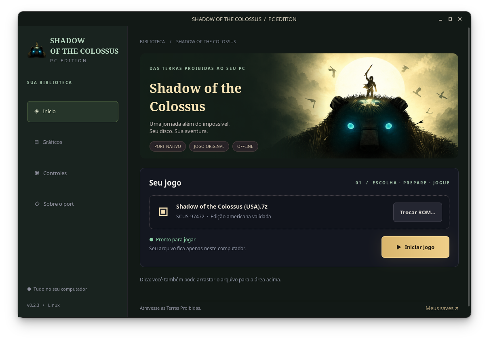
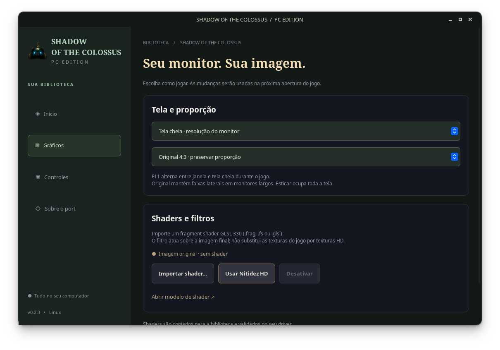

# Shadow of the Colossus PC — Linux

Port independente da edição **PS2 USA SCUS-97472**, com launcher em português,
recompilador local e renderizador nativo OpenGL. Desenvolvido a partir de
[Celosia](https://github.com/HenryKun55/celosia) e
[PS2Recomp](https://github.com/ran-j/PS2Recomp).

O executável MIPS do disco e os módulos KERNEL, MANAGER e GAMECORE são traduzidos
para C++ e compilados para x86_64 no seu computador. Modelos, texturas, animações
e áudio são lidos do seu disco. O jogo não roda em PCSX2 e não requer uma BIOS.
O runtime implementa os serviços do PS2 usados pelo jogo; a decompilação manual
continua em andamento na base Celosia.

**Nenhuma ROM, BIOS ou código gerado do jogo é distribuído.**



## Jogar

1. Baixe o pacote Linux em [Releases](https://github.com/GenissonEmilio/ShadowOfTheColossusPC/releases).
2. Extraia a pasta inteira e abra `ShadowOfTheColossusPC`.
3. Escolha seu disco `.iso`, `.7z`, `.zip` ou `.rar` da edição USA.
4. Aguarde a primeira compilação. Nas próximas sessões, clique em **Iniciar jogo**.

O compilador está incluído: o jogador não precisa instalar Docker, um SDK nem
executar comandos. A primeira preparação pode demorar. Até duas tarefas compilam
em paralelo, e a interface mostra o progresso. O cache é separado por versão do
compilador/runtime e validado antes de ser reutilizado.
Atualizações apenas da interface, shaders ou documentação preservam esse cache.

Requisitos: Linux x86_64 com **glibc 2.39+** (Ubuntu 24.04+, Fedora 40+), GPU com
OpenGL 3.3, 8 GB de RAM e pelo menos 15 GB livres. Uma CPU moderna e 16 GB de RAM
são recomendáveis para a compilação. Este pacote é exclusivamente para Linux.

A seção **Sobre** cria um atalho no menu de aplicativos. Os dados ficam em
`~/.local/share/ShadowOfTheColossusPC` (ou `XDG_DATA_HOME`). Os saves são imagens
de memory card em `player/memcards`. A ROM original permanece intacta.

## Tela cheia e shaders



Na aba **Gráficos**, escolha **Tela cheia · resolução do monitor** para usar o
monitor atual por inteiro. **Original 4:3** preserva a proporção e deixa faixas
nas laterais de telas largas; **Esticar** preenche toda a tela. F11 alterna entre
tela cheia e janela e salva a preferência. O menu F1 também ajusta a proporção.

**Importar shader…** copia e compila no seu driver um fragment shader de
pós-processamento **GLSL 330**, em `.frag`, `.fs` ou `.glsl`. A seleção anterior
é preservada quando a validação falha. **Usar Nitidez HD** ativa o filtro incluído;
**Desativar** restaura a imagem original. A mudança de shader vale na próxima
abertura do jogo e não recompila o código do jogo.

O modelo incluído usa `texture0`, `fragTexCoord`, `fragColor` e `colDiffuse`,
além de `sourceSize`, `outputSize` (pixels físicos) e `time` (segundos).
Filtros são aplicados à imagem do jogo antes do menu e do contador de FPS.
Shaders modificam a imagem final; não criam texturas HD nem aumentam a resolução
da geometria. Presets ReShade `.fx` e RetroArch `.slangp` não são compatíveis
diretamente. Veja [o formato e exemplos](docs/SHADERS.md).

## Controles

| Teclado | Controle PS2 |
| --- | --- |
| WASD | analógico esquerdo |
| setas | direcional |
| H / J / Y / U | ✕ / ○ / □ / △ |
| I / O | L1 / L2 |
| K / L | R1 / R2 |
| Z / X | Start / Select |
| F1 | configurações do port |
| F11 | tela cheia |

Controles USB/Bluetooth também são aceitos. O menu F1 ajusta vídeo, efeitos,
som e idioma da interface do port. Os textos originais do disco são preservados.
O mapeamento Linux inclui o Zikway HID gamepad / GameSir Nova Lite em modo HID
(USB `3537:1041`), inclusive direcionais, analógicos e gatilhos.
O runtime também inclui 743 registros Linux da base comunitária
[SDL_GameControllerDB](https://github.com/mdqinc/SDL_GameControllerDB), com GUIDs
adaptados ao GLFW. O jogo e o menu F1 usam o controle reconhecido que estiver
recebendo comandos, inclusive quando ele não está na primeira posição USB.
Reconectar o controle não exige reiniciar o jogo. Um modelo ainda ausente pode
usar um arquivo de mapeamento indicado por `PS2X_GAMEPAD_MAPPINGS` ou a variável
`SDL_GAMECONTROLLERCONFIG`.

## Correções de fidelidade em validação

As rotinas adicionais dos indicadores do HUD passam a ser capturadas, incluindo
o anel de carga do ataque. O cache de texturas verifica toda a paleta animada,
evitando reaproveitar cores e transparências antigas quando uma entrada muda.
As colisões usam por padrão o código original traduzido; as reescritas manuais
experimentais dessa parte ficam desativadas. Isso preserva também os registradores
VU0 que as reescritas não reproduzem integralmente.

Os testes sintéticos cobrem essas correções. A luta com o terceiro colosso,
os pontos fracos e os efeitos após derrotá-lo ainda precisam de uma reprodução
com save compatível; não foram declarados corrigidos apenas porque o build passou.
Consulte [o acompanhamento](docs/FIDELITY-2026-10.md).

## Compilar e verificar

Para desenvolver, instale Docker e Python 3, então execute:

```sh
python3 -m unittest discover -s tests/linux -v
tools/linux/build.sh
```

Esse build **não precisa da ROM** e gera o launcher, bibliotecas do runtime e o
kit de compilação. O pacote final é verificado para excluir imagens, executáveis
PS2, módulos XFF, código gerado e saves. O workflow Linux executa esses testes e
compila a cada push/PR. A execução do jogo é validada localmente com disco próprio;
CI não recebe arquivos do jogo.

O CI também testa a apresentação OpenGL em monitores virtuais 16:9 e ultrawide:
resolução nativa, barras, esticamento, pixels filtrados, rejeição de GLSL inválido,
desativação do filtro e retorno ao tamanho anterior da janela.

O pipeline original de desenvolvimento segue disponível em `./celosia`;
[a documentação da base](docs/UPSTREAM-CELOSIA.md) descreve seus estágios. Ele não
é o procedimento necessário para usar o release gráfico.

## Origem e licenças

- Base fixada em **HenryKun55/celosia e0bc43d6d4eb8cc1a022c4b277f396be3ee4fbbe**.
- Celosia e PS2Recomp: **GPL-3.0**, [LICENSE](LICENSE). O código correspondente do
  port também acompanha o release em `compiler/source`.
- Launcher Linux e ilustração vetorial original: GenissonEmilio, MIT em
  [tools/desktop/LICENSE](tools/desktop/LICENSE). Fluxo adaptado dos launchers
  ForbiddenMemoriesPC e CrashBandicootPC.
- [Tenkaichi3Decomp](https://github.com/stufno102/Tenkaichi3Decomp) foi referência
  para a experiência de importação e build PS2. Seu código de jogo é específico
  do Dragon Ball; ele não foi renomeado para executar Shadow of the Colossus.
- As bibliotecas do compilador mantêm suas licenças e identificação de versões
  em `compiler/licenses` e `compiler/packages.txt` no release.

Shadow of the Colossus pertence à Sony / Team Ico. Projeto não oficial, sem
vínculo com os titulares. Créditos completos da base estão na documentação Celosia.
